[Türkçe](#turkce) | [English](#english)

<a id="turkce"></a>

# asil-downloader

Brave, Chrome ve Edge için video, ses, altyazı ve resim indirme eklentisi. Açık sayfadaki videoyu [yt-dlp](https://github.com/yt-dlp/yt-dlp) ile seçtiğin kalitede MP4 olarak, sesi MP3/M4A/OPUS/FLAC/WAV olarak, altyazıyı SRT olarak indirir. Ekrandaki resimleri orijinal boyutlarıyla kaydeder. İndirdiğin dosyayı QR kodla telefonuna gönderebilirsin. Instagram story, öne çıkanlar ve gönderileri de indirir.

> **Önemli:** Eklenti, bilgisayarında çalışan küçük bir Python köprüsüyle (native messaging) haberleşir. Bu yüzden Chrome Web Mağazası'nda yok ve aşağıdaki [kurulum](#kurulum) adımlarını bir kez yapman gerekir. Yalnızca Windows'ta çalışır. Arayüz Türkiye'de Türkçe, diğer ülkelerde İngilizce açılır.

## Ekran görüntüleri

<p align="center">
  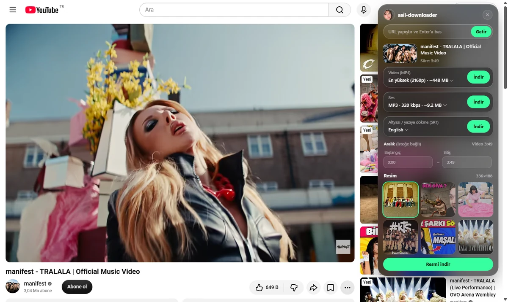
</p>

<table>
  <tr>
    <td align="center">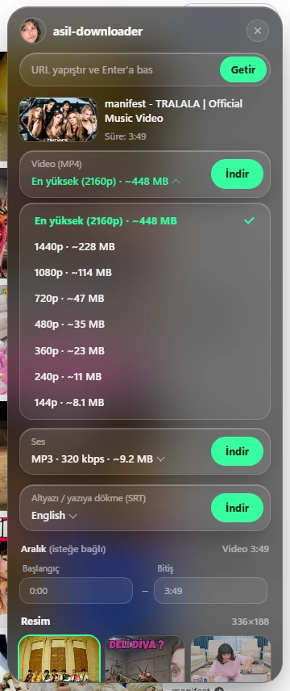<br><sub>Video kalitesi ve tahmini boyut</sub></td>
    <td align="center">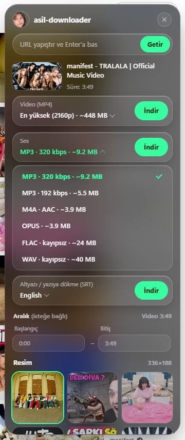<br><sub>Ses biçimi: MP3, M4A, OPUS, FLAC, WAV</sub></td>
    <td align="center">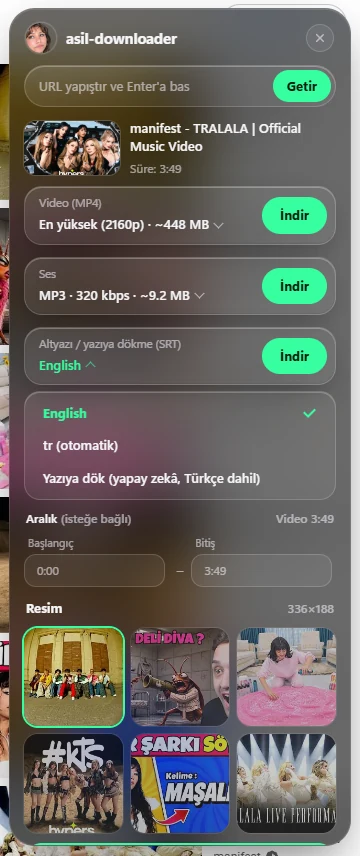<br><sub>Altyazı ya da yapay zekâ ile yazıya dökme</sub></td>
  </tr>
  <tr>
    <td align="center">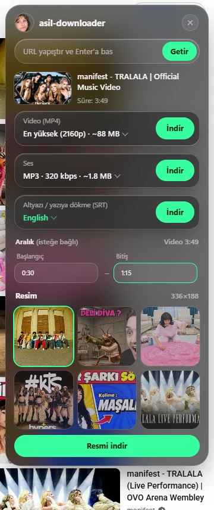<br><sub>Belirli bir aralığı indirme</sub></td>
    <td align="center">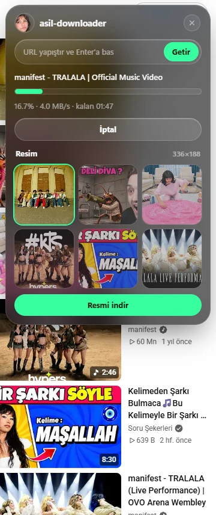<br><sub>İlerleme, hız ve kalan süre</sub></td>
    <td align="center">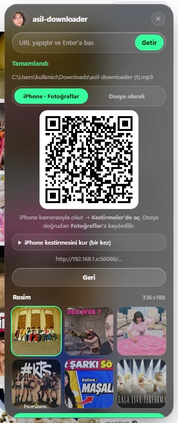<br><sub>QR kodla telefona gönderme</sub></td>
  </tr>
</table>

<sub>Örnek video: manifest – TRALALA (Official Music Video)</sub>

## Nasıl çalışır?

1. Eklenti ikonuna bastığında sayfanın sağ üstünde bir panel açılır.
2. Eklenti, sayfanın adresini bilgisayarındaki Python köprüsüne (`host/native_host.py`) gönderir.
3. Köprü, yt-dlp ile videonun başlığını, kalitelerini, ses dillerini ve altyazılarını okur. Panel bu seçenekleri listeler.
4. **İndir**'e bastığında yt-dlp ve ffmpeg dosyayı geçici bir klasöre indirir. İş bitince Brave'in **Farklı Kaydet** penceresi açılır ve dosya tarayıcının indirilenler listesine eklenir.

Popup'ı kapatsan bile indirme sürer.

## Gereksinimler

- Windows 10 veya 11
- Brave, Chrome ya da Edge
- Python 3.9 veya üstü
- `yt-dlp[default,curl-cffi]`, `segno` ve `faster-whisper` Python paketleri
- ffmpeg

<a id="kurulum"></a>

## Kurulum

### Hızlı kurulum

Projeyi indirip klasöre çıkardıktan sonra **`setup.bat`** dosyasına çift tıkla. Python, Python paketleri ve ffmpeg eksikse kurulur, köprü tarayıcılara kaydedilir. Bitince ekrandaki son adımı (eklentiyi tarayıcıya yükleme) yap. Klasör yolu panoya kopyalanır.

### Elle kurulum

Komutları PowerShell ya da Komut İstemi'nde çalıştır.

1. **Projeyi indir.** Sayfanın üstündeki **Code → Download ZIP** ile indirip bir klasöre çıkar ya da:

   ```bat
   git clone https://github.com/asiltares/asil-downloader.git
   cd asil-downloader
   ```

2. **Python'u kur** (yüklü değilse). [python.org](https://www.python.org/downloads/) üzerinden kurarken **Add python.exe to PATH** kutusunu işaretle ya da:

   ```bat
   winget install -e --id Python.Python.3.12 --scope user
   ```

   Kurulumdan sonra terminali kapatıp yeniden aç.

3. **Python paketlerini kur:**

   ```bat
   python -m pip install -U "yt-dlp[default,curl-cffi]" segno faster-whisper
   ```

4. **ffmpeg'i kur:**

   ```bat
   winget install -e --id yt-dlp.FFmpeg
   ```

5. **Köprüyü tarayıcılara kaydet.** Proje klasörünün içindeyken:

   ```bat
   python host/install.py
   ```

   Bu komut köprüyü Brave, Chrome ve Edge için kaydeder ve **Eklenti ID**'sini yazar. ID'yi not et.

6. **Eklentiyi yükle.** Brave'de `brave://extensions` sayfasını aç (Chrome için `chrome://extensions`, Edge için `edge://extensions`). **Geliştirici modu**nu aç, **Paketlenmemiş öğe yükle**'ye bas ve proje klasörünü (`manifest.json`'ın olduğu `asil-downloader` klasörü) seç.

7. Kartta görünen ID, 5. adımdaki ID ile aynı olmalı. Eklenti zaten yüklüyse kartındaki yenile simgesine bas.

Proje klasörünü başka bir yere taşırsan `setup.bat`'ı ya da 5. adımı tekrarla.

## Kullanım

Video sayfasında eklenti ikonuna bas.

| Özellik | Ne yapar? |
|---|---|
| **Video (MP4)** | Kaliteyi seç (varsayılan en yüksek) ve **İndir**'e bas. Her seçeneğin yanında tahmini dosya boyutu yazar. |
| **Ses** | MP3 320/192, M4A, OPUS, FLAC ya da WAV seç. |
| **Ses dili** | Videoda birden fazla dublaj varsa (ör. YouTube'da Türkçe dublaj) hangi ses kanalının ineceğini seç. |
| **Altyazı (SRT)** | Video altyazı sunuyorsa dilini seç. **Yazıya dök** seçeneği konuşmayı Whisper ile bilgisayarında yazıya döker. Dili kendisi bulur. İlk kullanımda yaklaşık 480 MB'lık model bir kez iner. |
| **Aralık** | Başlangıç ve bitişi `1:20`, `1:02:05` gibi yaz. Bitişi boş bırakırsan sona kadar iner. Video ve ses için geçerli. |
| **URL ile indir** | Panelin üstündeki kutuya bir bağlantı yapıştırıp Enter'a bas. O sayfaya gitmeden indirirsin. Kutudaki çarpıya basınca açık sayfaya dönersin. |
| **Sağ tık** | Bir linke, videoya ya da sese sağ tıklayıp **asil-downloader ile indir**'i seç. Resimlerde **Resmi indir (asil-downloader)** çıkar. |
| **Resim** | Ekranda görünen resimler panelin altında listelenir. Üstünde beklersen büyür. |
| **X (Twitter)** | Videoların sol üstünde **İndir** butonu çıkar. Giriş gerektiren videolarda X oturumun kullanılır. |
| **Telefona gönder** | İndirme bitince bir QR kod çıkar. Aynı Wi-Fi'daki telefonla okut. |
| **Dil** | Arayüz, IP adresinin bulunduğu ülkeye göre seçilir: Türkiye'de Türkçe, başka her yerde İngilizce. Haftada bir kontrol edilir. |

Önerilen dosya adları sırayla gelir: `asil-downloader (1)`, `asil-downloader (2)` … Kaydetmeyi iptal edersen geçici dosya silinir.

### Telefona gönder

İlk seferde Windows Güvenlik Duvarı Python için izin isteyebilir. **Özel ağlar** seçeneğine izin ver.

- **iPhone · Fotoğraflar:** QR kod, iPhone'daki *asil-downloader* kestirmesini çalıştırır ve dosyayı doğrudan Fotoğraflar'a kaydeder. Kestirmeyi bir kez kur: Kestirmeler → **+** → adını `asil-downloader` koy → **URL'nin İçeriğini Al** (URL: Kestirme Girdisi) → **Fotoğraf Albümüne Kaydet**. İlk çalıştırmada Yerel Ağ ve Fotoğraflar izinlerini ver.
- **Dosya olarak:** Dosya düz olarak iner. iPhone'da Dosyalar → İndirilenler'e, Android'de Galeri ya da İndirilenler'e düşer.

### Instagram

Brave'de Instagram'a giriş yapmış olman gerekir. Eklentiyi yeni kurduysan ya da yenilediysen önce Instagram sekmesini F5 ile yenile.

| Sayfa | Ne indirilir? |
|---|---|
| **Story** | Story'yi aç ve ikona bas. Ekrandaki story seçili gelir. |
| **Öne çıkanlar** | Her öğeyi ayrı seçebilir ya da **Hepsini indir**'e basabilirsin. |
| **Gönderi** | Kaydırmalı gönderilerde her öğe tek tek ya da **Hepsini indir** ile iner. Tek videolu gönderiler ve Reels yt-dlp ile iner. Ses biçimleri de kullanılabilir. |
| **Profil** | Profil sayfasında ikona basınca kişinin aktif story'leri ve bütün öne çıkanları listelenir. |

## Güncelleme

yt-dlp haftada bir arka planda kendiliğinden güncellenir. Kontrol, tarayıcı açıldıktan yaklaşık 30 saniye sonra yapılır. Bir site "eski sürüm" belirtisi olan bir hata verirse kontrol hemen yapılır. Yeni sürüm gelince bildirim çıkar ve köprü boştaysa kendini yeniden başlatır. Tarayıcıyı kapatmana gerek yok.

Elle güncellemek için:

```bat
python -m pip install -U "yt-dlp[default,curl-cffi]"
```

Son kontrol zamanı `%LOCALAPPDATA%\asil-downloader\update.json` dosyasında tutulur. Kayıtlar `%TEMP%\asil-downloader.log` dosyasına yazılır.

## Gizlilik

- İndirme, dönüştürme ve yazıya dökme bilgisayarında yapılır. Ses kaydı hiçbir sunucuya gönderilmez.
- Instagram ve X çerezleri yalnızca giriş gerektiren içerikleri indirmek için kullanılır. Bu çerezler yalnızca bilgisayarındaki köprüye (yt-dlp) iletilir.
- **Telefona gönder** için açılan bağlantı yalnızca yerel ağda çalışır. Her dosya için tahmin edilemez bir anahtar üretilir. Bağlantı bir saat sonra geçersiz olur.
- Arayüz dilini seçmek için eklenti haftada bir [country.is](https://country.is) servisine (çalışmazsa [ipapi.co](https://ipapi.co)) istek atar ve yalnızca ülke kodunu alır. Bu sırada servis IP adresini görür. Başka hiçbir veri gönderilmez.

## İzinler

| İzin | Neden gerekli? |
|---|---|
| `nativeMessaging` | Bilgisayardaki Python köprüsüyle (yt-dlp) konuşmak için |
| `activeTab`, `scripting` | İkona bastığında paneli açık sayfaya eklemek için |
| `tabs` | Açık sekmenin adresini okumak için |
| `downloads` | Dosyayı Farklı Kaydet penceresiyle kaydetmek için |
| `contextMenus` | Sağ tık menüsüne **asil-downloader ile indir** eklemek için |
| `notifications` | Güncelleme ve hata bildirimleri için |
| `storage` | Seçilen arayüz dilini hatırlamak için |
| `cookies` | Instagram ve X'te giriş gerektiren içerikleri indirmek için |
| `instagram.com`, `x.com`, `twitter.com` | Story, gönderi ve tweet videolarını bulmak için |

## Proje yapısı

```text
asil-downloader/
├── setup.bat            Tek tıkla kurulum
├── manifest.json        Eklenti tanımı (Manifest V3)
├── src/                 Eklenti kodu
│   ├── background.js    Köprüyle haberleşme, indirme, sağ tık menüsü
│   ├── overlay.js       Sayfaya eklenen panel
│   ├── popup.*          Panelin arayüzü
│   ├── i18n.js          Türkçe / İngilizce arayüz metinleri
│   ├── instagram.js     Instagram story, gönderi ve öne çıkanlar
│   ├── x-helper.js      X videolarındaki İndir butonu
│   └── icons/
├── host/                Python köprüsü (native messaging)
│   ├── native_host.py       Köprünün ana dosyası
│   ├── ytdlp_helpers.py     yt-dlp ayarları ve hata mesajları
│   ├── transcriber.py       Whisper ile yazıya dökme
│   ├── file_server.py       Telefona gönder sunucusu
│   ├── ytdlp_updater.py     Haftalık yt-dlp güncellemesi
│   ├── native_messaging.py  Tarayıcıyla mesajlaşma biçimi
│   └── install.py           Köprüyü tarayıcılara kaydeder
└── images/              Ekran görüntüleri (en/ İngilizce arayüz)
```

`host/host.bat` ve `host/host-manifest.json` dosyalarını `install.py` senin bilgisayarına göre üretir.

## Kaldırma

1. `brave://extensions` sayfasında eklentiyi kaldır.
2. Köprü kaydını sil:

```bat
reg delete "HKCU\Software\BraveSoftware\Brave-Browser\NativeMessagingHosts\com.asil.downloader" /f
reg delete "HKCU\Software\Google\Chrome\NativeMessagingHosts\com.asil.downloader" /f
reg delete "HKCU\Software\Microsoft\Edge\NativeMessagingHosts\com.asil.downloader" /f
```

3. İstersen `%LOCALAPPDATA%\asil-downloader` klasörünü ve proje klasörünü sil.

## Kapsam ve sınırlar

- Yalnızca Windows'ta çalışır. Kurulum yalnızca geçerli kullanıcı için yapılır.
- Desteklenen siteler yt-dlp'nin desteklediği sitelerdir. Bir site değişiklik yaptığında yt-dlp güncellenene kadar indirme çalışmayabilir.
- DRM ile korunan içerikler (Netflix, Spotify vb.) indirilemez.
- Eklenti kişisel kullanım içindir. İndirdiğin içeriklerin telif haklarına ve sitelerin kullanım koşullarına uymak senin sorumluluğundadır.

Bu proje işine yaradıysa bir ⭐ bırakabilirsin.

---

<a id="english"></a>

# asil-downloader

A video, audio, subtitle and image downloader extension for Brave, Chrome and Edge. It uses [yt-dlp](https://github.com/yt-dlp/yt-dlp) to download the video on the current page as MP4 in the quality you choose, the audio as MP3/M4A/OPUS/FLAC/WAV and the subtitles as SRT. It saves images on the page at their original size. You can send a finished download to your phone with a QR code. It also downloads Instagram stories, highlights and posts.

> **Important:** The extension talks to a small Python bridge (native messaging) running on your computer. That is why it is not on the Chrome Web Store, and you need to follow the [installation](#installation) steps below once. It only works on Windows. The interface is in English, or in Turkish when you are in Turkey.

## Screenshots

<p align="center">
  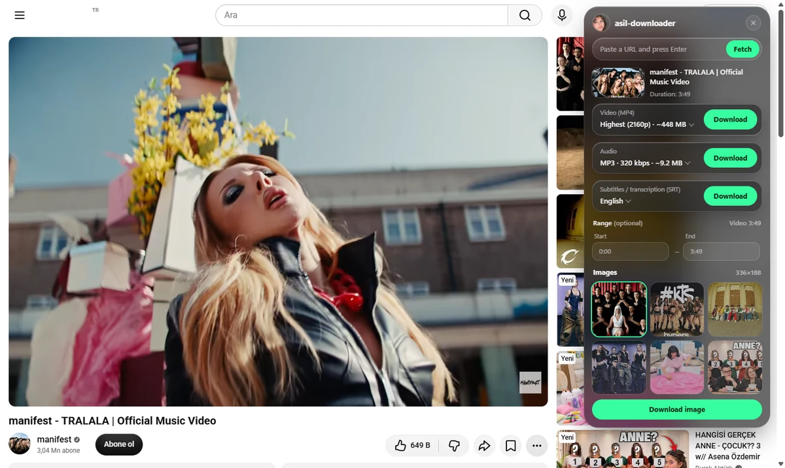
</p>

<table>
  <tr>
    <td align="center">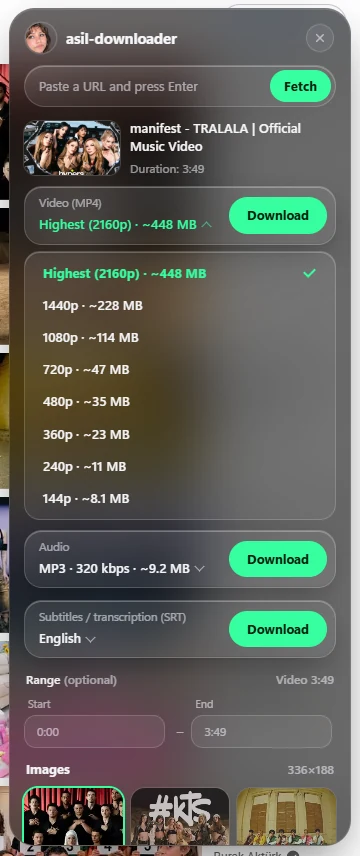<br><sub>Video quality with estimated size</sub></td>
    <td align="center">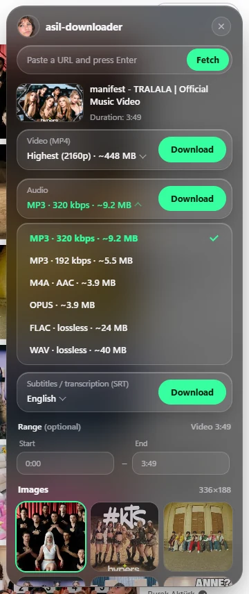<br><sub>Audio format: MP3, M4A, OPUS, FLAC, WAV</sub></td>
    <td align="center">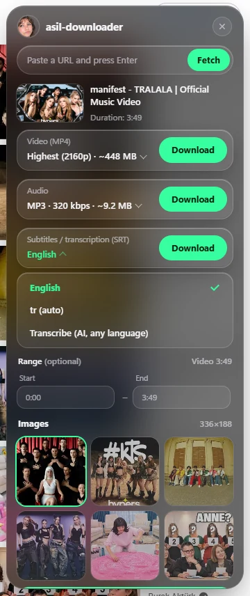<br><sub>Subtitles or AI transcription</sub></td>
  </tr>
  <tr>
    <td align="center">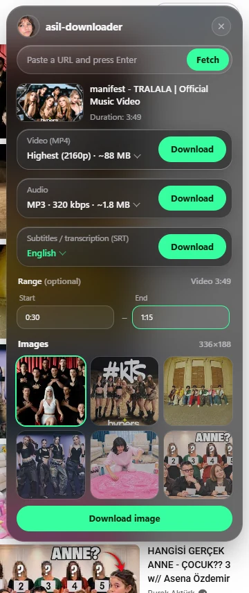<br><sub>Download a time range</sub></td>
    <td align="center">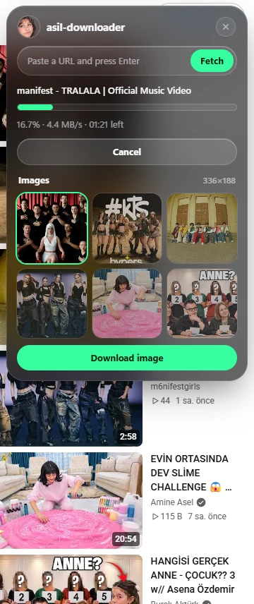<br><sub>Progress, speed and time left</sub></td>
    <td align="center">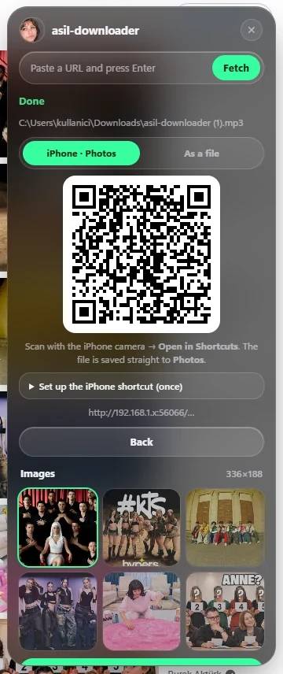<br><sub>Send to phone with a QR code</sub></td>
  </tr>
</table>

<sub>Sample video: manifest – TRALALA (Official Music Video)</sub>

## How does it work?

1. When you click the extension icon, a panel opens in the top right of the page.
2. The extension sends the page address to the Python bridge on your computer (`host/native_host.py`).
3. The bridge reads the title, qualities, audio languages and subtitles with yt-dlp. The panel lists these options.
4. When you click **İndir** (Download), yt-dlp and ffmpeg download the file to a temporary folder. When it finishes, the browser's **Save As** window opens and the file appears in the browser's download list.

The download keeps going even if you close the panel.

## Requirements

- Windows 10 or 11
- Brave, Chrome or Edge
- Python 3.9 or newer
- The `yt-dlp[default,curl-cffi]`, `segno` and `faster-whisper` Python packages
- ffmpeg

<a id="installation"></a>

## Installation

### Quick setup

After downloading and extracting the project, double-click **`setup.bat`**. It installs Python, the Python packages and ffmpeg if they are missing, and registers the bridge with your browsers. When it finishes, do the last step shown on screen (loading the extension in your browser). The folder path is copied to your clipboard.

### Manual setup

Run the commands in PowerShell or Command Prompt.

1. **Get the project.** Use **Code → Download ZIP** at the top of the page and extract it to a folder, or:

   ```bat
   git clone https://github.com/asiltares/asil-downloader.git
   cd asil-downloader
   ```

2. **Install Python** (if you don't have it). When installing from [python.org](https://www.python.org/downloads/), tick **Add python.exe to PATH**, or:

   ```bat
   winget install -e --id Python.Python.3.12 --scope user
   ```

   Close and reopen the terminal afterwards.

3. **Install the Python packages:**

   ```bat
   python -m pip install -U "yt-dlp[default,curl-cffi]" segno faster-whisper
   ```

4. **Install ffmpeg:**

   ```bat
   winget install -e --id yt-dlp.FFmpeg
   ```

5. **Register the bridge with your browsers.** From inside the project folder:

   ```bat
   python host/install.py
   ```

   This registers the bridge for Brave, Chrome and Edge and prints the **Eklenti ID** (extension ID). Note it.

6. **Load the extension.** Open `brave://extensions` in Brave (`chrome://extensions` in Chrome, `edge://extensions` in Edge). Turn on **Developer mode**, click **Load unpacked** and select the project folder (the `asil-downloader` folder that contains `manifest.json`).

7. The ID on the card must match the ID from step 5. If the extension was already loaded, click the reload icon on its card.

If you move the project folder, run `setup.bat` or step 5 again.

## Usage

Click the extension icon on a video page.

| Feature | What it does |
|---|---|
| **Video (MP4)** | Pick a quality (highest by default) and click **İndir**. Each option shows an estimated file size. |
| **Audio** | Pick MP3 320/192, M4A, OPUS, FLAC or WAV. |
| **Audio language** | If the video has several dubs (e.g. a Turkish dub on YouTube), pick the audio track to download. |
| **Subtitles (SRT)** | If the video has subtitles, pick a language. The **Yazıya dök** (transcribe) option transcribes speech on your computer with Whisper and detects the language itself. About 480 MB of model data downloads once on first use. |
| **Range** | Enter a start and end such as `1:20` or `1:02:05`. Leave the end empty to download to the end. Works for video and audio. |
| **Download by URL** | Paste a link into the box at the top of the panel and press Enter to download it without opening that page. Click the cross in the box to go back to the current page. |
| **Right-click** | Right-click a link, video or audio and pick **asil-downloader ile indir**. Images get **Resmi indir (asil-downloader)**. |
| **Images** | Images visible on the page are listed at the bottom of the panel. Hover over one to enlarge it. |
| **X (Twitter)** | A **İndir** button appears in the top left of videos. Videos that need a login use your X session. |
| **Send to phone** | When a download finishes, a QR code appears. Scan it with a phone on the same Wi-Fi. |
| **Language** | The interface language follows the country of your IP address: Turkish in Turkey, English everywhere else. It is checked once a week. |

Suggested file names are numbered: `asil-downloader (1)`, `asil-downloader (2)` … If you cancel the save, the temporary file is deleted.

### Send to phone

The first time, Windows Firewall may ask for permission for Python. Allow it on **Private networks**.

- **iPhone · Fotoğraflar (Photos):** The QR code runs the *asil-downloader* shortcut on your iPhone and saves the file straight to Photos. Set up the shortcut once: Shortcuts → **+** → name it `asil-downloader` → **Get Contents of URL** (URL: Shortcut Input) → **Save to Photo Album**. Allow Local Network and Photos access on the first run.
- **Dosya olarak (As a file):** A plain download. On iPhone it goes to Files → Downloads, on Android to Gallery or Downloads.

### Instagram

You need to be logged in to Instagram in Brave. If you just installed or reloaded the extension, refresh the Instagram tab with F5 first.

| Page | What it downloads |
|---|---|
| **Story** | Open the story and click the icon. The story on screen is preselected. |
| **Highlights** | Pick items one by one or click **Hepsini indir** (Download all). |
| **Post** | In carousel posts, download items one by one or with **Hepsini indir**. Single-video posts and Reels download through yt-dlp, so audio formats work too. |
| **Profile** | Click the icon on a profile page to list that person's active stories and all highlights. |

## Updates

yt-dlp updates itself in the background once a week. The check runs about 30 seconds after the browser starts. If a site returns an error that suggests an outdated version, the check runs right away. When a new version arrives, a notification appears and the bridge restarts itself when idle. You do not need to close the browser.

To update manually:

```bat
python -m pip install -U "yt-dlp[default,curl-cffi]"
```

The last check time is stored in `%LOCALAPPDATA%\asil-downloader\update.json`. Logs are written to `%TEMP%\asil-downloader.log`.

## Privacy

- Downloading, converting and transcribing happen on your computer. Audio is never sent to a server.
- Instagram and X cookies are used only to download content that needs a login. They are passed only to the bridge (yt-dlp) on your computer.
- The **Send to phone** link works only on your local network. Each file gets an unguessable key. The link expires after one hour.
- To pick the interface language, the extension sends a request to [country.is](https://country.is) (or [ipapi.co](https://ipapi.co) as a fallback) once a week and reads only the country code. The service sees your IP address while doing this. No other data is sent.

## Permissions

| Permission | Why is it needed? |
|---|---|
| `nativeMessaging` | To talk to the Python bridge (yt-dlp) on your computer |
| `activeTab`, `scripting` | To add the panel to the page when you click the icon |
| `tabs` | To read the address of the current tab |
| `downloads` | To save files with the Save As window |
| `contextMenus` | To add **asil-downloader ile indir** to the right-click menu |
| `notifications` | For update and error notifications |
| `storage` | To remember the chosen interface language |
| `cookies` | To download content that needs a login on Instagram and X |
| `instagram.com`, `x.com`, `twitter.com` | To find story, post and tweet videos |

## Project structure

```text
asil-downloader/
├── setup.bat            One-click setup
├── manifest.json        Extension definition (Manifest V3)
├── src/                 Extension code
│   ├── background.js    Bridge messaging, downloads, context menu
│   ├── overlay.js       Panel injected into the page
│   ├── popup.*          Panel UI
│   ├── i18n.js          Turkish / English UI strings
│   ├── instagram.js     Instagram stories, posts and highlights
│   ├── x-helper.js      Download button on X videos
│   └── icons/
├── host/                Python bridge (native messaging)
│   ├── native_host.py       Bridge entry point
│   ├── ytdlp_helpers.py     yt-dlp options and error messages
│   ├── transcriber.py       Whisper transcription
│   ├── file_server.py       Send-to-phone server
│   ├── ytdlp_updater.py     Weekly yt-dlp update
│   ├── native_messaging.py  Message format for the browser
│   └── install.py           Registers the bridge with browsers
└── images/              Screenshots (en/ for the English UI)
```

`install.py` generates `host/host.bat` and `host/host-manifest.json` for your computer.

## Removal

1. Remove the extension on `brave://extensions`.
2. Delete the bridge registration:

```bat
reg delete "HKCU\Software\BraveSoftware\Brave-Browser\NativeMessagingHosts\com.asil.downloader" /f
reg delete "HKCU\Software\Google\Chrome\NativeMessagingHosts\com.asil.downloader" /f
reg delete "HKCU\Software\Microsoft\Edge\NativeMessagingHosts\com.asil.downloader" /f
```

3. Optionally delete the `%LOCALAPPDATA%\asil-downloader` folder and the project folder.

## Scope and limitations

- Windows only. Setup is for the current user only.
- Supported sites are the sites yt-dlp supports. When a site changes, downloads may fail until yt-dlp is updated.
- DRM-protected content (Netflix, Spotify, etc.) cannot be downloaded.
- The extension is for personal use. You are responsible for respecting copyright and each site's terms of use.

If this project helped you, feel free to leave a ⭐.

This project is not affiliated with YouTube, Instagram, X or yt-dlp.
